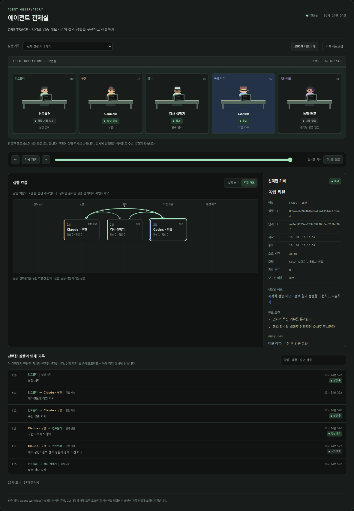

# Agent Workflow

v0.4.0: [에이전트 관제실과 업그레이드 안내](docs/OBSERVABILITY.ko.md) · [제품·연구 조사와 설계 근거](docs/OBSERVABILITY_RESEARCH.ko.md)

프로젝트 설정·복구·연속 실행: [v0.3 자동화 안내](docs/AUTOMATION_V0.3.ko.md)

[실제 v0.3 사용 결과와 남은 연결](docs/FOLLOWUP_STATUS.ko.md) · [Katakuri 프로젝트 설정](profiles/README.md)

[기본 개념과 Katakuri 파일럿 기록](docs/USER_GUIDE.ko.md)은 v0.2 시점 자료입니다.

[구성과 작업 흐름 보기](docs/workflow-blueprint.html) — 2026-10-08 설계 시점의 시뮬레이션입니다. 실제 실행 관측은 v0.4.0 관제실을 사용하세요.

WSL2에서 Codex·Claude가 같은 작업 상태를 사용하도록 연결하는 공용 스킬과 로컬 CLI입니다.
기존 WP/SRS/handoff를 참조하고, 구현 → 실제 검사 → 독립 리뷰 → 푸시·병합·배포 → 인계를 이어줍니다.
Python 3.11 이상, Git이 필요하며 Python 외부 의존성은 없습니다.

v0.3은 프로젝트 설정·별도 worktree 준비·파일 범위 예약·시간대 제한·유한 복구·검사 서버·
브라우저 증거·관리 문서·작업일지 내보내기·개별 중단/재개·호출/시간 한도·연속 실행을 연결합니다.
대시보드에서 등록된 프로젝트 설정으로 새 작업을 만들고 실행 옵션과 로그를 확인할 수 있습니다.

## 에이전트 관제실

```bash
agent-workflow serve --port 8765
```

`http://127.0.0.1:8765`에서 작업을 선택하면 역할별 픽셀 작업실, 실행 순서/역할 개요 그래프,
시간순 인계 기록과 선택 상세를 볼 수 있습니다. 구현·검사·독립 리뷰·수정·통합·배포의 실제
호출을 기록하며, 같은 상태 경로에서 실행한 CLI 작업도 반영됩니다. 관제실은 정상 연결 시
약 2초마다 갱신하고 연결이 끊기면 마지막 기록을 유지하면서 활동 표시를 멈춥니다.

기록 재생은 조회 시점만 바꿉니다. 작업 재실행이나 모델 호출·배포를 일으키지 않습니다.
stdout/stderr는 선택한 단계에서 버튼을 누를 때 최대 64 KiB를 읽습니다. CLI 내부 tool call,
subagent 전체와 기록되지 않은 대화는 추정하지 않습니다. 현재 코드의 검사·리뷰 증거는
과거 실행 성공과 별도로 표시합니다. 추가 runtime 의존성이나 외부 CDN은 없습니다.



화면 예시는 임시 Git 프로젝트와 검증용 CLI 프로세스로 만든 데모입니다. 실제 모델 서비스의 실행 성과를 나타내지 않습니다.

업그레이드 전에는 이전 데몬·전경 실행을 종료하고 상태 디렉터리를 백업하세요. SQLite의
revision·제어·관측 테이블은 자동으로 추가됩니다. 참조 문서가 있는 이전 진행 작업은 검사와
리뷰를 갱신해야 하며, 완료한 작업의 증거가 맞지 않거나 금지 경로의 등록 기준 hash가 없으면
새 작업으로 등록합니다. 자세한 범위·제어·이전 기록 처리는 [관제실 사용 안내](docs/OBSERVABILITY.ko.md)에 있습니다.

## 기존 WSL 설치 기록

아래 경로·포트는 기존 파일럿 환경의 기록입니다. 현재 설치·실행 상태는 `doctor`와
`daemon status`로 확인하세요.

- 코드: `/home/roqkf/agent-workflow`
- 명령: `~/.local/bin/agent-workflow`
- 공용 스킬 원본: `skills/agent-workflow/`
- 스킬 연결: `.codex`, `.claude`, `.claude-soonho`, `.claude-alex`의 `skills/agent-workflow`
- 기본 실행 상태: `~/.local/state/agent-workflow/state.sqlite3`
- 작업별 검사 로그·재개문·worklog: 위 상태 경로의 `tasks/<ID>/`
- 대시보드 주소: `http://127.0.0.1:8776`
- 로컬 시범 배포: `http://127.0.0.1:8776/demo`

설치된 스킬이 현재 대화의 목록에 없으면 새 Codex/Claude 세션에서 사용하세요.

```text
agent-workflow 스킬로 이 프로젝트의 WP-074를 진행해.
먼저 기존 문서에서 목표와 완료 조건을 확인하고 작업을 등록해.
이번에는 로컬 구현·검증까지 하고 커밋·푸시·병합은 하지 마.
```

## 빠른 시작

이미 있는 프로젝트에서 실제 WP와 검사 명령으로 등록합니다. 아래 경로/명령은 예시입니다.

```bash
agent-workflow doctor
agent-workflow create WP-074 --project /path/to/project \
  --goal '검색 결과에서 필요한 정보를 바로 확인할 수 있다' \
  --criterion '대상 사용자 흐름이 실제로 동작하고 관련 회귀 검사를 통과한다' \
  --ref docs/40_delivery/work_packages.md \
  --check 'python3 -m unittest discover -s tests' \
  --owner claude --reviewer codex
agent-workflow run WP-074 --dry-run
agent-workflow run WP-074 --timeout 900 --repairs 1
agent-workflow show WP-074
```

`--check`, `--criterion`, `--ref`는 여러 번 줄 수 있습니다. 설치된 CLI의 기본 모델과
로그인을 그대로 사용합니다. 역할별 모델을 설정할 수 있고, 일시 오류에는 미리 지정한
대체 모델만 사용합니다. 계정 자동 전환과 새 API 키 생성은 하지 않습니다.
명령은 셸을 거치지 않고 argv로 실행됩니다. `&&`, 파이프, 리다이렉션이 필요하면 저장소의
검사 스크립트 하나로 묶어 등록하세요. 검사 명령은 호출한 사용자의 권한으로 실행되므로
현재 작업에서 승인된 명령만 등록하세요.

## 평소 대화형 작업에 붙여 쓰기

스킬로 작업을 진행하되 다른 모델을 자동 호출하지 않을 수도 있습니다.

```bash
agent-workflow list
agent-workflow brief WP-074
agent-workflow checkpoint WP-074 --summary '입력 처리 수정; UI 검증은 아직' --next '관련 회귀 검사 실행'
agent-workflow check WP-074
agent-workflow brief WP-074 --role review
```

독립 검토자는 생성한 리뷰 입력과 현재 코드를 읽고 JSON 결과를 반환합니다. `show`의
`observed_git.fingerprint`를 리뷰 시작 전에 기록합니다. 참조 문서가 있으면 같은 시점의
`refs_fingerprint`도 함께 기록하고 다음과 같이 등록합니다(참조가 없으면 해당 옵션 생략).

```bash
agent-workflow review-import WP-074 --file /tmp/review.json --reviewer codex \
  --fingerprint <검토한-코드-지문> --refs-fingerprint <검토한-참조-지문>
agent-workflow finish WP-074
agent-workflow handoff WP-074
```

결과 JSON 구조는 `agent-workflow result-schema`와
[스킬 명령 참고](skills/agent-workflow/references/commands.md)에 있습니다.
작은 수정은 생성 시 `--reviewer none`으로 독립 리뷰를 생략할 수 있습니다.
검사 없는 작업은 등록할 수 있지만 `finish`할 수 없습니다. 필요한 검사를 정한 후
`agent-workflow check-add WP-074 '검사 명령'`으로 추가합니다.

## 자동 실행의 범위

`run`은 한 작업을 대상으로 하는 유한한 전경 프로세스입니다.

1. 구현 담당에게 현재 목표·기준 코드·인계·완료 조건을 전달합니다.
2. 관리 도구가 등록된 검사 명령을 실제로 실행하고 종료 코드와 로그를 기록합니다.
3. 지정된 다른 에이전트가 읽기 전용 독립 리뷰를 수행합니다.
4. 차단 결함은 설정한 횟수 안에서 수정합니다. 기본 추가 수정 1회, 최대 3회입니다.
5. 현재 코드와 검사·리뷰 증거가 일치하면 로컬 `completed`로 기록하고 인계를 생성합니다.
6. `release-config`가 있으면 지정한 원격·브랜치·배포 명령으로 릴리스를 이어갑니다.

Claude 실행은 `--safe-mode`와 파일 도구를 사용합니다. 사용자 훅·플러그인·메모리에
의존하지 않으며, 프로젝트 지침은 프롬프트에서 직접 읽도록 요청합니다. 셸 검사는 관리
도구가 실행합니다. Codex는 구현 시 workspace-write, 리뷰 시 read-only 샌드박스를
사용하고 추가 승인이 필요한 행동은 자동 우회하지 않습니다.

권한·계정 한도·응답 형식 오류는 `blocked`와 로그로 남습니다. 시간 초과·일시 오류는
설정한 복구 횟수 안에서만 처리합니다. 중단된 구현의 변경은 실제 검사와 독립 리뷰를
통과해야 완료할 수 있습니다. `out of credits`는 반복 호출하지 않으며, 원인을 해결한 뒤
같은 작업을 재개합니다. 유효한 검사·리뷰 증거는 다시 사용합니다.

```bash
agent-workflow show WP-074
agent-workflow assign WP-074 --owner codex --reviewer claude
agent-workflow run WP-074 --timeout 900 --repairs 1
```

담당 변경은 실행 중 같은 워크트리의 잠금을 획득할 수 있을 때만 됩니다.
프로세스별 timeout과 작업별 누적 명령 시간·에이전트 호출 한도를 사용할 수 있습니다.
금액은 CLI가 보고한 값만 기록하며, 사후 중단 기준은 결제 상한을 보장하지 않습니다.
자동 작업에는 CLI 계정 사용량이 발생합니다.

## 상태와 증거

| 항목 | 의미 |
|---|---|
| `ready` | 등록됨 / 체크포인트에서 이어갈 수 있음 |
| `implementing`, `checking`, `reviewing` | 마지막 기록된 실행 단계 |
| `needs_review`, `ready_to_finish` | 검사 또는 리뷰를 마친 상태 |
| `blocked` | 실패·중단·사용자 입력 등 차단 사유와 로그가 있음 |
| `completed` | 등록된 검사·지정 리뷰가 기록된 코드에서 통과 |

`show`는 현재 코드와 비교한 `verification_is_current`, `review_is_current`,
`completion_is_current`를 별도로 표시합니다. 과거 완료 후 코드가 바뀌어도 과거 이력은
보존하고 현재 유효 여부를 구분합니다. 완료된 작업을 다시 덮지 말고 새 작업으로 등록하세요.

- 지문에는 HEAD·index·추적 파일·무시되지 않은 untracked 파일·submodule 상태가 포함됩니다.
- 명시한 `forbidden_paths`는 Git ignore 여부와 별도로 hash를 비교하며, `refs`는 파일 내용·
  존재·링크를 검사·리뷰 증거에 연결합니다. 그 밖의 무시된 빌드 결과·환경변수·외부 데이터는
  코드 지문 범위 밖입니다. 그런 입력이 중요한 작업은 검사에서 해당 버전/해시를 확인하세요.
- 검사가 코드를 바꾸면 통과로 인정하지 않습니다. 생성 파일은 의도된 Git ignore 정책에
  따라 처리한 뒤 검사를 다시 실행하세요.
- 검사 명령에는 `PYTHONDONTWRITEBYTECODE=1`을 기본으로 전달합니다(이미 지정한 값은 유지).
  모든 검사가 성공했는데 기존 파일 변경 없이 **새 미추적 파일만** 생겼다면, 모델을 다시
  부르지 않고 같은 검사를 한 번 더 실행합니다. 두 번째 실행에서 트리가 바뀌지 않아야 통과이며,
  생긴 파일은 `verification.check_created_files`에 남습니다. 추적 파일·index·HEAD 변경이나
  매번 새 파일을 만드는 검사는 여전히 실패입니다. 생긴 파일도 작업 범위 검사와 릴리스 대상
  경로 규칙을 그대로 받으므로 Git ignore 정리는 계속 필요합니다.
- 독립 리뷰 결과는 모델 또는 검토자의 보고입니다. 내용의 완전한 정확성을 보장하지 않습니다.
- 수동 `review-import`의 검토자 이름은 사용자가 제공한 귀속 정보입니다. 신원 인증은 아닙니다.
- 검사 로그와 에이전트 원문은 로컬에 남습니다. 공개 저장소로 자동 업로드하지 않습니다.

## 중단·동시 실행

Git의 worktree별 관리 디렉터리에 OS 파일 잠금을 둡니다. 서로 다른 상태 저장 경로를
사용해도 같은 worktree의 관리 실행은 하나만 허용됩니다. 별도 Git worktree는 동시에
사용할 수 있습니다. 이 잠금은 도구를 통하지 않은 에디터/에이전트까지 막지는 못합니다.

일반 중단·timeout은 관리 중인 프로세스 그룹을 종료합니다. 부모가 강제 종료돼도 직접
실행한 자식이 살아 있으면 넘겨준 잠금 FD가 잠금을 유지합니다. 자식까지 종료되면 OS가
해제합니다. `show`의 마지막 단계는 생존 확인이 아니므로 이전 로그와 실제 프로세스를
확인하고 재개하세요. 임의 PID를 대상으로 자동 종료하지 않습니다.

상주 데몬은 등록된 큐를 순서대로 처리합니다. 재시작 시 대기 작업은 보존하고 실행 중이던
작업은 `interrupted`로 표시합니다. 결과가 불명확한 외부 작업을 자동 재실행하지 않습니다.

## 자동 푸시·병합·배포

아래는 사용자에게 승인된 작업에 구체적인 릴리스 대상을 연결하는 예시입니다.
실제 저장소·파일·배포 명령으로 바꿔 사용하세요. 깨끗한 Git 기준선에서 생성한 작업이 필요합니다.

```bash
agent-workflow release-config WP-074 \
  --repo OWNER/REPO --remote origin --base main --branch workflow/wp-074 \
  --path src --path tests \
  --deploy 'python3 scripts/deploy.py' \
  --health 'python3 scripts/health.py'
agent-workflow pipeline WP-074 --dry-run
agent-workflow pipeline WP-074
```

- GitHub 대상과 실제 fetch/push URL이 일치해야 합니다. 사후 원격 변경은 차단합니다.
- 검증된 변경 중 지정 경로만 커밋합니다. 경로 밖의 staged/unstaged 변경이 있으면 중단합니다.
- 작업 브랜치를 non-force push하고 PR을 생성하거나 동일 커밋의 기존 PR을 이어갑니다.
- 원격 commit status와 check runs를 확인하고 정확한 후보 SHA를 지정해 병합합니다.
  CI가 없는 저장소는 `--allow-no-ci`를 명시해야 합니다. 관리자 우회 옵션은 사용하지 않습니다.
- 배포가 없어도 실제 병합 결과를 검사합니다. Local 모드는 기준 브랜치 push 전에 검사하며,
  GitHub는 실제 병합 SHA의 검사 결과를 별도로 기록합니다. 통합 검사 실패는 배포와 후속 작업을 막습니다.
- 배포·health 명령에 `WORKFLOW_REVISION`, `WORKFLOW_TASK_ID` 환경변수를 전달합니다.
  health 명령은 단순 생존 여부뿐 아니라 기대한 revision이 적용됐는지 확인하도록 작성하세요.
- 외부 배포 명령은 사용자가 지정한 프로그램을 실행합니다. 특정 호스팅 서비스의 자격 증명이나
  프로젝트를 자동으로 만들거나 추정하지 않습니다. 성공한 배포를 반복 호출해도 재배포하지 않습니다.
- 배포 명령 결과가 실패/불명확하면 자동 재실행을 막습니다. 실제 상태를 확인한 후
  `agent-workflow release WP-074 --retry-deploy`로 명시적으로 재시도할 수 있습니다.
- 배포 명령 성공 후 health만 실패한 경우 다음 `release`는 health부터 재확인합니다.
- 릴리스 상태는 로컬 `completed`와 별개입니다: `configured → committed → pushed →
  pull_request → merged → deploying → deployed`. 실패 사유와 각 커밋·명령 결과가 원장에 남습니다.

기존 CLI 로그인(`gh`)과 해당 원격 Git 권한을 사용합니다. GitHub 경로는 API 경계 테스트로
검증했고 실제 커밋·푸시·병합·배포는 로컬 bare 원격에서 검증했습니다. 외부 운영 저장소는
사용자가 지정한 후 연결합니다. `release --timeout`은 CI 대기·명령·Git/API를 포함한 한 릴리스
호출의 전체 기한입니다. 각 단계에서 시간대·수동 보류·남은 시간도 다시 확인합니다.

## 상주 데몬과 대시보드

```bash
agent-workflow daemon start --port 8776
agent-workflow daemon status
agent-workflow queue WP-074                 # 구현부터 설정된 릴리스까지
agent-workflow queue WP-074 --action release # 로컬 완료 작업의 릴리스만
agent-workflow jobs
agent-workflow hold WP-074 --reason '다음 단계 전 확인 필요' # task와 기존 대기열 보류
agent-workflow unhold WP-074                # 기존 queued 작업은 다시 실행 가능
agent-workflow cancel JOB_ID                # queued 상태만 취소
agent-workflow stop JOB_ID                  # 해당 실행에만 중단 요청
agent-workflow resume JOB_ID                # 실패·중단·취소된 실행 재개
agent-workflow daemon stop
```

브라우저에서 `http://127.0.0.1:8776`을 열면 프로젝트 설정을 이용한 작업 등록, 검색·상세·
실행 옵션·큐 등록·중단·재개·최근 로그·알림을 사용할 수 있습니다. 로컬 완료와 실제 병합·배포를
분리해 표시합니다. 웹에서 임의 셸 명령을 입력받지는 않습니다. 서버는 loopback에만 바인딩하고
Host/Origin·요청 토큰을 검사합니다. 같은 OS 계정 사용자를 서로 격리하는 서비스는 아닙니다.

화면 우상단에서 다크·라이트 테마를 전환할 수 있고 선택한 테마와 작업은 브라우저에 저장됩니다.
`/` 키로 작업 검색에 이동합니다. 단계 표시에서는 리뷰 생략·배포 미설정·오래된 검증을
완료와 구분합니다. 화면의 수치는 실제 작업/실행 기록에서 계산하며 외부 CDN은 사용하지 않습니다.

UI 회귀 검사는 `node tests/ui_scenarios.mjs http://127.0.0.1:8776`으로 실행합니다.
이 선택적 개발 검사는 Playwright가 필요하며, 설치된 `playwright` 또는 web-probe 런타임을
사용합니다(`WORKFLOW_PLAYWRIGHT_PATH`로 경로 지정 가능). API를 브라우저 안에서 가로채므로
실제 작업 실행·배포를 요청하지 않습니다. 사용자용 CLI·대시보드에는 Playwright가 필요 없습니다.
실제 임시 SQLite·HTTP·큐와 합성 CLI를 연결하는 관제실 브라우저 검사는
`python3 tests/observability_integration.py`로 실행합니다. 모델 과금이나 운영 배포는 호출하지 않습니다.

`service-install --enable`은 사용자 systemd가 있으면 서비스를 등록하고, 없으면 대화형 Bash 로그인
시작 파일의 관리 구역에 데몬 시작을 연결합니다. `--enable` 없이 실행하면 파일만 준비합니다.
WSL 자체 부팅·Windows 로그인 예약은 설정하지 않습니다. 전경 실행은 `serve --port 8776`입니다.

로컬 시범 작업은 다음과 같이 준비할 수 있습니다. `DEMO-RELEASE`는 시범임을 표시하며
실제 개발 프로젝트의 진척률로 집계하지 마세요.

```bash
agent-workflow demo-setup
agent-workflow queue DEMO-RELEASE --action release
```

## 기존 handoff/worklog와 연결

`handoff`가 하나의 상태에서 다음을 만듭니다.

- `state.json`: 작업 계약·증거·현재 유효성
- `resume.txt`: 정확한 상태 저장 경로와 재개 명령을 포함한 대화형 인계
- `worklog.md`: 실제 상태·검사·리뷰, 흐름도와 요약을 담은 작업일지

프로필에 `documents`를 지정하면 저장소 문서의 관리 구역을 검사 전에 갱신합니다.
`exports.directory`를 지정하면 날짜와 작업 ID로 작업일지를 내보냅니다. 사용자가 바꾼 기존
작업일지는 덮어쓰지 않습니다. 전체 대화 export와 기존 handoff 팩 재구축은 별도입니다.

## 설치·검증

```bash
python3 install.py
python3 -m unittest discover -s tests -v
```

설치기는 기존 항목을 덮어쓰지 않습니다. CLI와 이미 존재하는 Codex·Claude 프로필에
같은 소스의 심볼릭 링크를 만듭니다. 셸 설정·로그인 설정을 변경하지 않습니다.

실제 모델 연결 검사는 명시적으로 실행합니다. 프로젝트 소스 아래 무시되는
`artifacts/live-*`에 작은 Git fixture와 로그를 보존합니다.

```bash
python3 tests/live_smoke.py --owner claude --reviewer codex --timeout 180
python3 tests/live_smoke.py --owner codex --reviewer claude --timeout 180
```

검사·리뷰는 등록된 로컬 범위에 대한 것이며, `completed`는 PR 병합·배포·사내 반입을
뜻하지 않습니다. 외부 단계는 `release` 기록의 병합 SHA·배포 SHA·health 결과를 확인하세요.
릴리스가 검증된 내용 그대로 커밋한 경우 `evidence_bound_via_release`로 기존 검증과 새 커밋의
연결을 표시합니다. 실제 소스가 추가로 바뀌면 해당 연결은 유효하지 않습니다.

구현에 확인한 자료: 설치된 Codex 0.160.1 / Claude Code 2.1.292 `--help`,
[Codex 구조화 리뷰 예제](https://developers.openai.com/cookbook/examples/codex/build_iterative_repair_loops_with_codex),
[Claude 비대화형 실행](https://code.claude.com/docs/en/headless).
릴리스 API는 [GitHub PR 병합](https://docs.github.com/en/rest/pulls/pulls#merge-a-pull-request),
[commit statuses](https://docs.github.com/en/rest/commits/statuses),
[check runs](https://docs.github.com/en/rest/checks/runs)를 참조했습니다.
