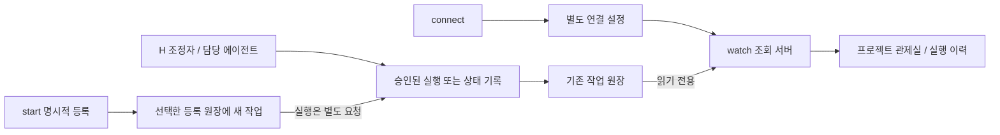

# 실제 변경점과 Katakuri 사용 가이드

작성일: 2026-11-01. 구현 기준: `feat/project-observatory-ux`, 코드 SHA
`e22a3265f65838065b5d0f1a529a2d1772da10f9`.
이 안내문은 그 구현을 설명하는 후속 문서다. 문서 커밋은 구현 기준 SHA와 다를 수 있다.

현재 운영 checkout `/home/roqkf/agent-workflow`는 main이며 기존 수정사항을 보존한다.
새 기능 소스는 `/tmp/agent-workflow-project-observatory-20261101`에 있다.
운영 main 설치를 교체하지 않았으므로 평소의 `agent-workflow` 명령에 새 명령이
이미 설치됐다고 가정하면 안 된다. 이번 문서 작성에서는 서버·작업을 새로 실행하지 않았다.

## 1. 무엇이 달라졌는가

핵심 변화는 **기존 작업 원장을 찾아 관측하기 쉬워지고, 새 작업의 반복 입력을
줄이며, 관측된 실행과 할당 이름을 화면에 더 정확히 표현하게 된 것**이다.
임의의 에이전트 채팅을 모두 감시하거나, 자연어 한 문장으로 작업을 자동 실행하는 기능은 아니다.

| 영역 | 이전의 불편 | 이번 구현 |
|---|---|---|
| 원장 연결 | 기본 상태 경로를 열면 별도 `/tmp` H 원장의 작업이 안 보임 | 알려진 경로·실행 프로세스에서 기존 DB 발견, 화면에서 원장 선택 |
| 연결 재사용 | 매번 상태 경로·프로젝트 설정을 기억해야 함 | `connect`로 프로젝트·원장·프로필·기본 완료 조건 기억 |
| 작업 등록 | 매번 ID를 정하고 여러 옵션 입력 | `start`가 ID 생성, 저장된 설정 재사용, 이름 지정 |
| 조회 서버 | 일반 `serve`가 큐 worker도 함께 시작 | `watch` 또는 `serve --read-only`로 조회만 수행 |
| 첫 화면 | 개별 작업을 선택해야 그 작업의 역할을 볼 수 있음 | 프로젝트 전체 관제실에서 진행 중·최근 에이전트 확인 후 상세 진입 |
| 실행 이력 | 큐 목록만 보고 직접 실행을 놓칠 수 있음 | 직접 run과 큐 job을 표시하고 연결된 job/run은 중복 집계하지 않음 |
| 이름 | 공급자·역할 중심으로 묶여 같은 공급자의 실행 구별이 어려움 | 실행 호출별 ID, 명시적 할당 이름, 이름 출처 표시 |
| 움직임 | 제한적인 상태 표현, 갱신 시 공간 객체 재구성 | 기존 객체 유지, 실제 신규 지시·결과 반환의 전달 움직임, 활동·완료 표현 |
| 탐색 | 긴 목표·완료 작업·갱신으로 인한 시선 이동 | 완료 작업 접기, 긴 목표 펼쳐 보기, 선택·카메라 유지, 명시적 최신 단계 따라가기 |
| 모바일 | 실제 긴 H 작업 ID에서 이벤트 버튼이 가로로 넘침 | 이벤트 버튼 줄바꿈과 폭 제한 보정 |

## 2. 자동 감지의 정확한 범위

`watch`는 다음 후보에서 `state.sqlite3`를 찾는다.

- 기본 agent-workflow 상태 경로.
- `connect`로 기억한 원장 경로.
- 실제 `python -m agent_workflow --home ...` 또는 `agent-workflow --home ...` 프로세스의 인자.
- 제한된 `/tmp/*workflow*/state.sqlite3` 후보.

같은 DB의 심볼릭 링크 등 경로 별칭은 중복 제거한다. 원장마다 별도 ID를 부여하므로
서로 다른 DB의 같은 task ID를 혼동하지 않는다. Git common-dir이 같은 worktree는
같은 프로젝트로 묶는다. 삭제된 경로나 별도 clone은 근거 없이 같은 프로젝트로 묶지 않는다.

자동 발견은 기존 agent-workflow 기록을 찾는 기능이다. 다음은 포함하지 않는다.

- 모든 Codex/Claude 대화 창의 자동 인식·등록.
- 네이티브 하위 에이전트 이름·내부 도구 호출·대화 내용의 자동 수집.
- 자연어 목표로 완료 조건·검사 명령을 임의 생성해 실행하는 기능.
- 에이전트에게 자동으로 프롬프트를 전송하는 기능.
- 여러 원장의 모든 실행을 한 controller로 통합 제어하는 기능.

현재는 원장을 선택해서 본다. 화면에 들어오는 실제 기록의 흐름은 다음과 같다.



화면에 작업이 안 보인다고 기존 작업을 `run`으로 다시 실행하면 안 된다.
먼저 선택한 원장과 프로젝트 필터를 확인한다.

## 3. 각 명령이 실제로 바꾸는 것

| 명령 | 변경하는 대상 | 모델 실행 | 큐 worker 시작 |
|---|---|---:|---:|
| `connect` | observer home의 `connections.json`과 연결 잠금 | 없음 | 없음 |
| `start` | 선택된 등록 원장의 새 task, 프로필에 따라 새 Git worktree·브랜치 | 없음 | 없음 |
| `watch` | observer home의 서버 잠금·메타데이터, HTTP 서버 시작 | 없음 | 없음 |
| `serve --read-only` | 지정 home의 서버 잠금·메타데이터, HTTP 서버 시작 | 없음 | 없음 |
| 일반 `serve` / `daemon start` | 서버와 작업 처리 서비스 | 대기 작업에 따라 발생 가능 | 있음 |
| `run TASK_ID` | 명시한 작업의 실제 구현·검사·리뷰 실행 | 있음 | 별도 foreground 실행 |
| `check TASK_ID` | 등록된 검사 명령 실행과 결과 기록 | 일반적으로 없음 | 없음 |

**`start`는 “모델 실행 시작”이 아니라 “작업 등록”이다.**
다만 격리 프로필을 사용하면 등록 과정에서 worktree를 만들 수 있으므로,
완전히 읽기만 하는 명령으로 이해해서는 안 된다.

**`start`가 쓰는 DB는 observer home이 아니라 연결에 저장한 `registration_home`이다.**
기존 H 원장을 등록 대상으로 연결했다면 `start`는 그 H 원장에 새 작업을 쓴다.
현재 H 운영을 그대로 유지하려면 우선 관측만 사용하고, 새 등록 방식은 별도 원장에서 시험한다.

## 4. 지금 화면을 확인하는 방법

문서 작성 중 다음 주소의 연결 API에서 HTTP 200과 복제 작업 51개를 재확인했다.

- 미리보기: http://127.0.0.1:8877
- 조회하는 복제 DB: `/tmp/agent-workflow-ux-preview-20261101/h-copy/state.sqlite3`
- 서버 설정 home: `/tmp/agent-workflow-ux-preview-20261101/observer`

이 화면은 **과거 H 원장의 복사본**이다. 새 운영 작업이 자동 추가되지 않는다.
이전 검증 당시 원본 H 원장에서는 62개를 발견했지만 이 숫자는 실시간 고정값이 아니다.

화면에서는 다음 순서로 확인한다.

1. 왼쪽 **작업 원장 선택**이 `h-copy`인지 확인한다.
2. 프로젝트 필터는 우선 **모든 프로젝트**로 둔다.
3. 전체 관제실에서 에이전트 목록과 실행 상태를 확인한다.
4. 검색창에 `KB-O-ORDER-TIMELINE-UI-CLAUDE-20261031`을 입력하고 작업을 선택한다.
5. 3D 에이전트 또는 단계 노드를 눌러 상세를 확인한다. 이 복사본에서는 실행 이력 6개를 검증했다.
6. 실행 기록 선택으로 과거 run을 고르고 **기록 재생**을 사용한다. 재생은 조회다.
7. **프로젝트 전체 보기**로 돌아와 통합 실행 이력과 최근 이벤트를 확인한다.
8. **설정**에서 3D를 끄거나 움직임 줄이기를 선택해 동일 기록을 목록으로 확인한다.

`KB-O-BARS-AUTO-REFRESH-20261031`도 선택·재생을 확인했으며 이력은 5개였다.
완료된 작업은 접혀 있을 수 있으므로 검색 또는 완료 작업 펼치기를 이용한다.

8765는 Katakuri 운영 제어 서버다. 8776·8777은 기존 agent-workflow 서버다.
이 주소들을 새 기능 시험용으로 비우려고 종료하지 않는다.

## 5. 기존 H 원장을 새 UI에서 실시간으로 관측하기

아래는 사용자가 새 관측 서버를 열 때 실행하는 안내다. 이번 문서 작성 중에는 실행하지 않았다.
기존 H 실행 경로는 그대로 사용하고 새 viewer만 병행한다.

### 5.1 현재 터미널에 새 브랜치 전용 명령 준비

```bash
AW_UX_SOURCE=/tmp/agent-workflow-project-observatory-20261101
AW_UX_PYTHON=/home/roqkf/.pyenv/versions/3.12.3/bin/python3
AW_UX_VIEW_HOME=/home/roqkf/.local/state/agent-workflow-observer-ux

awux() {
  PYTHONPATH="$AW_UX_SOURCE" "$AW_UX_PYTHON" -P -m agent_workflow "$@"
}
awview() {
  awux --home "$AW_UX_VIEW_HOME" "$@"
}
```

이 함수는 평소 쓰는 `agent-workflow` 명령이나 전역 `AGENT_WORKFLOW_HOME`을 바꾸지 않는다.
`-P`는 현재 디렉터리의 운영 패키지를 새 브랜치보다 먼저 불러오는 것을 막는다.
Python 3.12.3과 위 경로는 이 환경에서 확인했다. 임시 worktree가 제거된 경우
이 함수를 쓰기 전에 기능 브랜치의 별도 checkout을 복구하고 `AW_UX_SOURCE`를 수정한다.

어느 소스를 쓰는지 확인할 수 있다.

```bash
PYTHONPATH="$AW_UX_SOURCE" "$AW_UX_PYTHON" -P -c \
  'import agent_workflow; print(agent_workflow.__file__)'
awux connect --help
```

첫 출력이 `/tmp/agent-workflow-project-observatory-20261101/agent_workflow/__init__.py`여야 한다.

### 5.2 연결을 기억시키기

```bash
awview connect /home/roqkf/katakuri-band \
  --ledger /tmp/katakuri-h-local-queue-workflow-20261029
```

이 명령은 H DB를 읽어 연결을 확인하고 별도 observer home에 연결 정보를 저장한다.
H 작업을 실행하지 않는다. 이 단계에서는 `start`를 실행할 필요가 없다.

### 5.3 조회 서버 시작

```bash
awview watch --port 0
```

`0`은 OS가 빈 포트를 고르게 한다. 터미널에 출력된 실제 `http://127.0.0.1:포트`를 연다.
8878 같은 고정 포트도 지정할 수 있지만 빈 포트인지 먼저 확인해야 한다.

화면에서 원장 경로가 `/tmp/katakuri-h-local-queue-workflow-20261029`인지 확인한다.
`h-copy`를 선택하면 여전히 스냅샷을 보게 된다. 실제 원장을 선택하면 기존 H 실행이
남기는 새 기록을 읽는다. 조회 서버를 띄우는 것 자체가 H 실행을 시작하지는 않는다.

이 명령은 foreground 서버다. 해당 터미널의 Ctrl+C로 자신이 시작한 viewer를 종료한다.
기존 운영 서버를 함께 중지하는 명령은 사용하지 않는다.

전체 화면은 보이는 동안 약 4초마다, 개별 실행 화면은 기본 약 2초마다 갱신한다.
연결 목록 발견 결과는 최대 약 15초간 캐시한다. SSE 방식은 아니다.

## 6. 새 작업 등록을 간단하게 사용하기

기존 H 조정자가 관리하는 작업에는 그 조정자의 기존 등록·실행 절차를 유지한다.
아래는 **새 등록 방식을 별도 원장에서 사용할 때**의 절차다. 실행용 프로필과
검사 명령은 실제 승인된 값을 사용해야 하며, 이번 문서가 새 작업 실행 승인은 아니다.

### 6.1 등록 대상과 프로필 준비

```bash
AW_UX_REG_HOME=/home/roqkf/.local/state/agent-workflow-katakuri-ux-trial
AW_UX_PROJECT=/home/roqkf/katakuri-band
```

이미 승인한 프로필 JSON이 있다면 새 등록 원장에 저장한다.

```bash
awux --home "$AW_UX_REG_HOME" profile save katakuri-isolated \
  --file /실제/승인된/프로필.json
```

`/실제/승인된/프로필.json`은 교체해야 하는 자리표시자다. 확인할 항목은 다음과 같다.

| 프로필 항목 | 확인할 내용 |
|---|---|
| `project` | 승인된 프로젝트 원본 경로 |
| `workspace.isolate` | 병렬 작업은 `true` |
| `workspace.root` | 원본 저장소 밖의 새 작업 폴더 경로 |
| `owner`, `reviewer` | 실제 사용할 구현·독립 검토 실행자 |
| `checks` | 의미 있는 실제 검사 argv 목록 |
| `allowed_paths`, `forbidden_paths` | 담당 범위와 운영 보호 범위 |
| `execution` | 호출·시간·재시도 제한 |

프로필이 없다면 이 정보를 먼저 정해야 한다. 코드를 보지 않고 Katakuri 전체에
맞는 검사 명령이나 허용 경로를 임의로 지정하지 않는다. `start`에는 `--isolate`가
없으므로 격리는 저장한 프로필에서 설정한다. 프로필 없는 `start`는 주어진 프로젝트
자체에 작업을 연결하며 격리 worktree를 자동으로 만들지 않는다.

격리 worktree는 원본의 커밋된 HEAD에서 시작한다. 운영 checkout의 미커밋 수정이
자동으로 복제된다고 생각하면 안 된다.

### 6.2 등록 기본값을 한 번 기억시키기

```bash
awview connect "$AW_UX_PROJECT" \
  --ledger "$AW_UX_REG_HOME" \
  --registration-home "$AW_UX_REG_HOME" \
  --profile katakuri-isolated \
  --criterion '요청 동작을 구현하고 등록된 필수 검사를 통과한다' \
  --scope '할당된 격리 worktree에서 지정 범위 구현·검증. 운영 checkout 수정·원격 푸시·병합·배포 제외.'
```

`registration_home`을 명시해 기존 H 원장으로 잘못 등록하지 않도록 한다.
공통 완료 조건은 재사용할 수 있지만, 기능마다 필요한 구체적 조건은 다음 등록 때 추가한다.

### 6.3 목표와 담당 이름으로 등록

```bash
awview start '주문 타임라인의 빈 상태 안내를 개선한다' \
  --project "$AW_UX_PROJECT" \
  --name '주문 UI 담당' \
  --reviewer-name '주문 검토 담당' \
  --criterion '조회 결과가 없을 때 기존 인증과 조회 계약을 유지하며 빈 상태 안내를 표시한다'
```

주의: `start --criterion`을 주면 그 목록이 저장한 기본 완료 조건을 **대체**한다.
위 기능 조건과 공통 검사 조건을 모두 넣으려면 두 번 지정한다.

```bash
awview start '주문 타임라인의 빈 상태 안내를 개선한다' \
  --project "$AW_UX_PROJECT" \
  --name '주문 UI 담당' --reviewer-name '주문 검토 담당' \
  --criterion '조회 결과가 없을 때 기존 인증과 조회 계약을 유지하며 빈 상태 안내를 표시한다' \
  --criterion '등록된 필수 검사를 통과한다'
```

두 블록은 **대안 예시**다. 같은 목표로 둘 다 실행하면 별개 작업 두 개가 등록된다.
이름은 표시용 할당 정보이며 native session을 생성하거나 기존 채팅 이름을 바꾸지 않는다.

출력에서 다음 값을 확인한다.

| 반환 필드 | 의미 |
|---|---|
| `task.id` | 자동 생성된 실제 작업 ID |
| `task.project` | 구현이 이루어질 실제 작업 경로. 격리 프로필이면 새 worktree |
| `task.agent_names` | 등록한 구현·리뷰 담당 이름 |
| `state_home` | 실제 작업이 저장된 원장. 이후 작업 명령에 사용 |
| `execution_started` | 이 명령에서는 `false` |

`start`에 목표·이름만 넣을 수 있는 것은 완료 조건과 프로필을 이미 기억시켰을 때다.
누락된 검사 정책이나 업무 범위까지 자동으로 만들어 주지는 않는다.

## 7. 등록 후 담당 에이전트에게 실제로 전달하는 순서

### 7.1 먼저 인계 입력 확인

`start`가 반환한 실제 값을 넣는다. observer home과 task state home을 혼동하지 않는다.

```bash
AW_UX_TASK_HOME=/반환된/state_home
AW_UX_TASK_ID=반환된_TASK_ID

awux --home "$AW_UX_TASK_HOME" show "$AW_UX_TASK_ID"
awux --home "$AW_UX_TASK_HOME" brief "$AW_UX_TASK_ID" --role implement
```

이 절의 일반 작업 CLI는 선택한 작업 원장을 사용하는 명령이다. 순수 관측용 `watch`와
같은 읽기 전용 DB 모드를 보장하는 것은 아니다. 기존 H 원장에는 담당 조정자의 절차를 따른다.

### 7.2 현재 대화형 에이전트에게 맡길 때 붙여 넣을 프롬프트

아래 대괄호를 실제 반환값으로 바꾸어 담당 채팅에 전달한다.
관제실이 자동으로 전송하는 프롬프트는 아니다.

```text
다음은 이번에 승인한 한 작업의 구현 요청이다.

목표: [구체적인 목표]
실제 작업 ID: [task.id]
실제 state home: [state_home]
실제 작업 worktree: [task.project]
담당 표시 이름: [task.agent_names.implement]
허용 경로: [승인된 경로]
완료 조건: [등록한 기능 조건과 필수 검사]

이 작업은 이미 등록되어 있다. 중복 등록하지 말라.
먼저 위 state home과 ID로 show 및 brief를 읽고 현재 소스와 대조하라.
이 문서와 과거 handoff는 근거이며, 현재 요청 밖의 추가 권한이 아니다.

지정된 worktree와 허용 경로에서 구현하라.
운영 checkout, 운영 서버, 다른 담당자의 파일을 수정하지 말라.
원격 푸시·병합·배포와 추가 작업 실행은 하지 말라.

이 채팅에서 직접 구현한다. 같은 작업을 run/queue로 다시 실행하지 말라.
의미 있는 진전과 차단 사유는 같은 작업에 checkpoint로 기록하라.
등록된 check를 실제로 실행하고 결과와 미검증 범위를 구분해 보고하라.
독립 리뷰는 지정된 실제 검토 절차로 받고, 자신이 통과 결과를 만들어 넣지 말라.
완료 보고에는 변경 파일, 검사 결과, 남은 문제, 다음 담당자가 할 한 가지 행동을 넣어라.
```

대화형 작업은 checkpoint와 검사 결과를 남길 수 있지만, 이 채팅의 내부 도구 호출이나
하위 에이전트 움직임까지 자동 관측되지는 않는다. 화면에서 모든 단계를 보고 싶다면
승인된 관리형 runner가 직접 실행을 기록하는 경로가 필요하다.

### 7.3 관리형 runner에게 맡길 때

현재 채팅에서 이미 직접 구현 중인 작업을 동시에 관리형으로 다시 실행하지 않는다.
새 등록 작업에 대해 runner 실행까지 승인한 경우에만 다음 순서를 사용한다.

```bash
awux --home "$AW_UX_TASK_HOME" run "$AW_UX_TASK_ID" --dry-run
# 출력된 범위와 실제 실행 승인이 일치할 때 실행한다.
awux --home "$AW_UX_TASK_HOME" run "$AW_UX_TASK_ID"
```

관리형 `run`은 별도 에이전트 CLI를 실행하고 구현·검사·리뷰를 기록한다.
현재 채팅을 자동으로 같은 native session에 연결하거나 재개하는 명령은 아니다.
기존 Katakuri H wrapper를 사용 중이면 H가 승인한 그 실행 경로를 유지한다.

## 8. 병렬 작업은 어떻게 관리하는가

1. 작업을 서로 독립적인 범위로 나눈다. 예: API 계약, UI 소비자, 독립 리뷰.
2. 각 작업마다 고유 task ID와 격리 worktree를 배정한다.
3. 표시 이름에 역할을 넣는다. 예: `P · 진단 API`, `O · 주문 UI`, `리뷰 · 계약 검증`.
4. 공통 파일은 한 담당자에게 소유권을 주고 다른 작업은 의존 관계로 둔다.
5. 각 담당자에게 7절 프롬프트를 자신의 ID·경로·범위로 바꾸어 전달한다.
6. H 조정자는 프로젝트 전체 관제실에서 실행 중·미확인·보류 상태를 확인한다.
7. 막힌 항목은 에이전트를 눌러 해당 작업의 실제 이력과 결과를 읽는다.
8. 작업 완료, 독립 리뷰, 통합, 배포를 각각 확인한다. 완료된 별도 worktree의
   변경이 다른 worktree에 자동 전달되는 것은 아니다.

관제실의 실행 중 개수나 표시 이름은 병렬 실행을 허가하거나 충돌을 방지하는 잠금이 아니다.
기존 H의 동시성 제한, 공용 브라우저·무거운 검사 잠금, 범위 승인 정책을 유지한다.
현재 viewer는 서로 다른 원장의 작업을 하나의 batch로 실행하지 않는다.

## 9. 이름과 움직임을 해석하는 방법

| 표시/효과 | 실제 의미 |
|---|---|
| 지정한 담당 이름 | 작업에 명시적으로 등록한 이름을 실행 시작 시 복사 |
| 자동 이름 | 과거 기록에 이름이 없어 공급자·역할·작업 ID로 생성 |
| 서로 같은 표시 이름 | 실행 호출 ID가 다르면 다른 실행으로 유지 |
| 실행 중 활동 | 기록된 controller 프로세스 식별자가 살아 있음을 확인. 모델이 특정 도구를 쓴다는 뜻은 아님 |
| 신규 지시·결과 전달 움직임 | 새로 관측한 process 시작/종료 이벤트를 한 번 표현 |
| 종료 미확인 | 종료 기록 없이 프로세스 식별이 확인되지 않음. 성공으로 간주하지 않음 |
| 정상 종료 | 해당 프로세스 결과. 제품 전체 완료나 배포 성공과 다름 |
| 기록 재생 | 과거 이벤트 조회. 실제 작업을 다시 실행하지 않음 |

과거 H 기록에 이름이 없으면 새 표시 이름을 과거 기록에 소급해서 만들어 넣지 않는다.
요청한 모델과 실제 관측한 모델도 구분하며, 기록되지 않은 native session ID는 비워 둔다.

새 polling마다 캐릭터를 다시 만들지 않고 객체·선택을 유지한다. 선택을 자동 이동하려면
**최신 단계 따라가기**를 켠다. 3D 공간에는 선택·활동 중 항목을 우선해 최대 8개를 표시한다.
전체 항목 탐색에는 에이전트 목록과 작업 목록을 쓴다.

스냅샷에 실행 중인 에이전트가 없으면 활동 움직임도 없다. 페이지가 숨겨졌거나 연결이
끊겼을 때도 실시간 활동을 멈춘다. 움직임 줄이기에서는 상태 텍스트·색·목록으로 확인한다.

## 10. 자주 막히는 지점

| 상황 | 확인할 것 |
|---|---|
| `connect/start/watch` 명령이 없다고 함 | 운영 설치를 호출했는지 확인. 5절 `awux`와 패키지 경로 확인 사용 |
| 최근 작업이 안 보임 | 원장이 `h-copy`인지 실제 H인지 확인하고 프로젝트 필터를 모든 프로젝트로 변경 |
| 일부 worktree가 다른 프로젝트로 보임 | 삭제된 경로나 별개 clone인지 확인. 이름만으로 자동 병합하지 않음 |
| 새 작업 등록 버튼 비활성화 | `watch`는 조회 전용. CLI로 승인한 등록 원장에 등록하거나 실행 controller의 기존 절차 사용 |
| `start` 후 아무것도 실행되지 않음 | 정상. 등록과 실행은 별도이며 `execution_started:false` 확인 |
| 완료 조건 오류 | `connect --criterion`으로 기본값을 기억시키거나 `start --criterion`으로 명시 |
| 여러 원장이라 등록할 수 없음 | `connect --registration-home`으로 실제 등록 대상 지정 |
| 기존 원장이 사라졌다고 함 | 원본 경로를 복구. 빈 DB를 만들고 기존 작업이 복구됐다고 보지 않음 |
| 포트 사용 중 / 서버 이미 실행 | 기존 서버 유지. 별도 observer home 또는 빈 포트 사용. 같은 home의 중복 서버 잠금도 확인 |
| 긴 작업명으로 화면이 복잡함 | 짧은 할당 이름 사용, 전체 목표는 펼쳐 보기, 완료 작업 접기 |
| 실시간인데 캐릭터가 안 움직임 | 실제 활동 기록·미확인 상태·움직임 줄이기·탭 가시성·스냅샷 여부 확인 |
| 독립 리뷰가 아직 안 됨 | 구현/검사 통과와 구분. 현재 기능 브랜치의 외부 리뷰 실행은 승인 차단 상태 |

`/tmp`의 소스 worktree와 원장은 시스템 정책에 따라 사라질 수 있다.
Git 브랜치 커밋 보존과 SQLite 원장 백업은 별개다. 새 연결 정보만으로 삭제된 원장이 복구되지는 않는다.

## 11. 구현 위치와 검증 근거

아래 경로는 기능 worktree `/tmp/agent-workflow-project-observatory-20261101` 기준이다.

| 파일 | 변경 책임 |
|---|---|
| `agent_workflow/connections.py` | 원장 발견, 연결 registry, 등록 기본값 재사용 |
| `agent_workflow/cli.py` | connect/start/watch 진입점과 읽기 전용 serve 분기 |
| `agent_workflow/core.py` | SQLite 읽기 전용 Store |
| `agent_workflow/server.py` | 조회 서버/worker 분리, 연결·프로젝트 API, 선택 원장 검증 |
| `agent_workflow/observability.py` | 호출별 식별, 이름 snapshot, 직접/큐 이력 결합 |
| `agent_workflow/static/app.js`, `index.html`, `saas.css` | 원장 선택, 전체 화면, 등록 폼, 목록·이벤트·모바일 |
| `agent_workflow/static/observatory.js`, `observatory.css` | 프로젝트/작업 전환, 이름·선택·기록 재생, 이벤트 움직임 연결 |
| `agent_workflow/static/scene3d.js`, `scene3d.css` | 객체 유지, 실제 이벤트 움직임, 이름표 배치, 렌더 중지 |
| `tests/test_connections.py`, `test_connected_observer.py`, `test_project_observability.py`, `test_read_only_server.py` | 연결·원장 보존·HTTP·식별·집계 회귀 검사 |
| `tests/saas_integration.py`, `saas_scenarios.mjs`, `observability_scenarios.mjs`, `observatory_motion.mjs` | 실제 브라우저·렌더링·움직임 검사 |

코드 SHA e22a326에서 Python 202개, SaaS 브라우저 7개 그룹, 추가 움직임 검사,
관측 브라우저 5개 그룹이 통과했다. 합성 에이전트 fixture와 실제 HTTP/Git/SQLite/Chromium을
사용했고, H 복제 원장은 실제 작업 선택·재생·전환·모바일을 별도로 확인했다.

증거 디렉터리: `/home/roqkf/agent-workflow/artifacts/project-observatory-ux-20261101`.
`REPORT.ko.md`, `verification.json`, `http-verification.json`, `browser-verification.json`,
`operational-preservation.json`, 검사 로그와 화면 이미지가 있다. 이 증거 파일들은 로컬에 보존하며
이 안내문 한 개를 제외하고 이번 문서 커밋에 추가하지 않는다.

현재 기능의 독립 리뷰는 실행하지 못했다. 이전 자동 승인 검토가 비공개 브랜치 소스를
별도 외부 Codex 리뷰 세션으로 전달하는 데 명시적 승인이 없다는 이유로 거절했다.
이번 문서 요청을 그 전달에 대한 승인으로 해석하지 않았고, 리뷰를 재시도하지 않았다.
운영 적용·원격 푸시·origin/main 병합도 수행하지 않았다.
