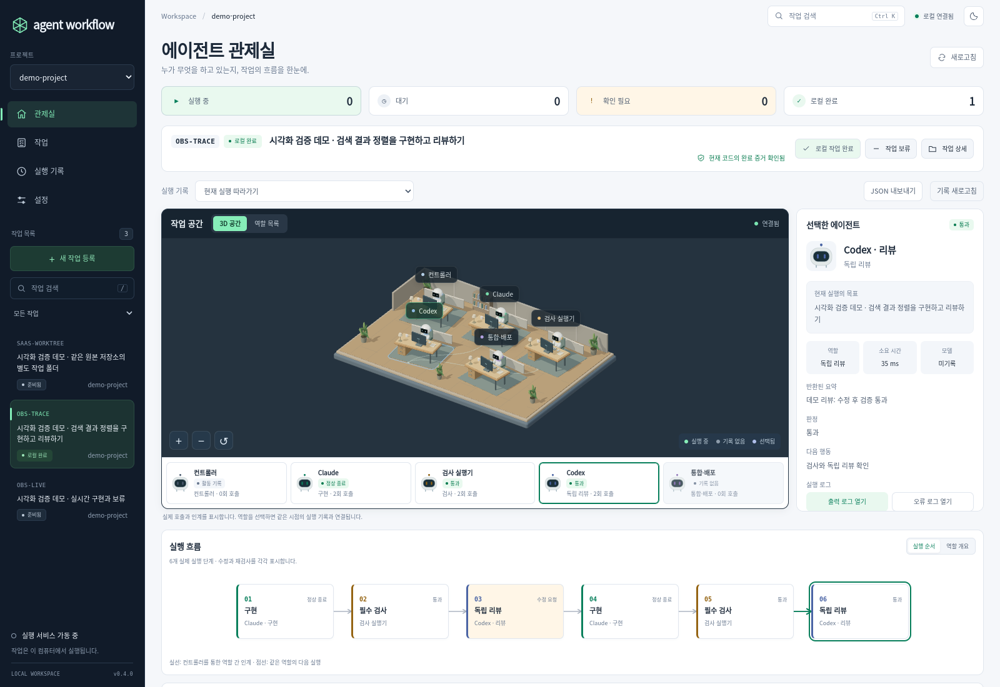

# Three.js 관제실과 SaaS형 워크스페이스

## 설계와 구현

2026-10-30의 후속 요청에 따라 완성 화면 시안을 먼저 이미지로 제작한 뒤 UI 구현을 진행했다. 밝은 작업 화면과 어두운 탐색 영역, 입체적인 작업실, 선택 상세, 실행 흐름과 인계 기록을 연결한다. 관측·실행·보류·릴리스 계약은 기존 v0.4 모델을 사용한다.

이 화면은 실제 로컬 컨트롤러와 연결되는 운영 도구다. 숫자·에이전트 상태·실행 이력은 task/job/run/span/event에서 가져온다. 수익·구독·팀 계정 등의 미구현 기능을 동작하는 것처럼 표시하지 않는다.



화면 자료는 합성 에이전트 CLI를 실행하는 임시 Git 프로젝트의 실제 관측 기록이다. 모델 성능이나 운영 배포 실적을 뜻하지 않는다.

## 탐색 구조

| 영역 | 동작 |
|---|---|
| 프로젝트 선택 | 원본 저장소 단위로 작업·큐·알림·지표를 필터링한다. |
| 관제실 | 선택한 작업의 3D 공간·역할 목록·단계 상세·실행 그래프·인계 기록을 확인한다. |
| 작업 | 작업 목표·완료 조건·현재 증거·검사와 리뷰·참조·실행 옵션을 확인한다. |
| 실행 기록 | 선택한 프로젝트의 큐 작업과 최근 실행 25개를 보고 중단·취소·재개·로그 조회를 수행한다. |
| 설정 | 화면 테마·3D 표시·동작 줄이기를 변경하고 컨트롤러 상태·버전·등록 profile을 확인한다. |

프로젝트는 `task.workspace.source`, `task.project_config.project`, `task.project`의 순서로 원본을 찾는다. 같은 원본의 격리 worktree를 각각 다른 프로젝트로 분리하지 않는다. 프로젝트 profile은 새 작업에 적용하는 실행 프리셋이며, 같은 원본에 여러 profile이 있을 수 있다.

상단의 실행 중·대기 지표는 선택한 프로젝트의 **큐 job 수**다. 별도 터미널에서 직접 호출한 CLI 실행의 활동은 관제실에서 확인한다. 확인 필요는 blocked·hold·release error가 있는 task 수이며, 로컬 완료는 `completed` task 수다. 이 수치는 기간별 성공률이나 과금 자료가 아니다.

작업 검색은 `Ctrl + K`, macOS의 `⌘ + K`, 또는 입력 중이 아닐 때 `/`로 이동한다. 작은 화면에서는 탐색 메뉴가 열리며, `Esc`로 닫을 수 있다. 메뉴를 여는 동안 배경은 조작되지 않고 키보드 포커스는 메뉴 안에 유지된다.

## 3D 공간

Three.js `0.187.0`과 OrbitControls로 작업실을 그린다. 둥근 플랫폼, 책상·모니터·키보드·의자·작은 로봇, 식물과 칸막이는 코드로 만든 독자적인 geometry다. 원격 모델·텍스처·폰트나 다른 제품의 sprite를 다운로드하지 않는다.

- 에이전트나 책상을 클릭하면 같은 실행 단계의 inspector·그래프·역할 버튼이 선택된다.
- 마우스 드래그로 제한된 범위에서 시점을 돌리고, 확대·축소와 초기화 버튼으로 구도를 조절한다.
- 터치 환경에서는 페이지의 세로 스크롤을 우선한다. 역할 버튼과 확대·초기화 버튼으로도 탐색할 수 있다.
- 관측된 인계만 바닥 경로에 표현한다. 아직 호출하지 않은 단계나 직접 대화하지 않은 관계를 추가하지 않는다.
- 역할 목록은 키보드·스크린리더 조작 경로이며, WebGL을 사용할 수 없을 때도 유지된다.

렌더러는 관측 API를 직접 호출하지 않는다. `observatory.js`가 현재 재생 시점에 맞춰 만든 actor와 인계 관계를 전달한다. 그래프·3D·선택 상세는 같은 시점과 선택 상태를 사용한다.

### 활동과 성능

연속 애니메이션은 실제 실행 중인 actor가 있고, 연결된 라이브 화면이며, 페이지와 작업실이 보이고, 동작 줄이기가 꺼져 있을 때만 수행한다. 과거 재생이나 연결 끊김을 현재 실행 중인 활동으로 표현하지 않는다.

렌더러는 활동 시 초당 최대 약 30회로 갱신하고, idle 상태에서는 변경이나 카메라 조작에 응답해 그린다. 다른 메뉴·숨겨진 탭·화면 밖 작업실에서는 연속 프레임을 멈춘다. DPR은 최대 1.75로 제한하고, 정적인 가구의 shadow map은 배치가 바뀔 때 갱신한다. 이 상한은 하드웨어별 프레임 속도를 보장하는 수치가 아니다.

WebGL 초기화 실패나 context loss는 화면에 이유를 표시한다. 이 경우에도 역할 선택·그래프·인계 기록·작업 제어를 계속 사용할 수 있다. 표시 설정에서 3D를 끌 수도 있다.

## 화면 설정

테마, 선택한 프로젝트와 메뉴, 3D 사용 여부, 동작 줄이기 설정은 현재 브라우저의 localStorage에 보관한다. 저장 기능이 차단된 브라우저에서도 기본값으로 동작한다. 새 방문의 기본 테마는 라이트이며 기존에 저장한 테마는 유지한다.

화면 설정은 작업 계약이나 모델·검사·보류 상태를 변경하지 않는다. 실행 옵션은 작업 화면에서 다음 큐 등록에 적용하며, 작업 보류는 기존처럼 별도의 실제 제어 요청이다.

## 설치와 개발

사용자는 기존 Python 설치와 `agent-workflow serve`를 사용한다. `three-vendor.js`와 라이선스가 Python 패키지의 정적 자산에 포함되며, 실행 시 npm이 필요하지 않다.

프런트엔드 개발과 번들 재현에는 Node.js가 필요하다.

```bash
npm ci
npm run build
npm run check:vendor
```

`package-lock.json`은 Three.js와 esbuild 버전을 고정한다. `check:vendor`는 고정한 소스를 다시 번들링해 저장소의 번들과 비교한다. 출처와 라이선스는 [THIRD_PARTY_LICENSES.md](../THIRD_PARTY_LICENSES.md)에 있다.

주요 파일:

| 파일 | 책임 |
|---|---|
| `agent_workflow/static/app.js` | 프로젝트 필터, 메뉴, 작업·큐 제어, 화면 설정 |
| `agent_workflow/static/saas.css` | 제품형 shell, 화면 계층, 모바일 탐색과 테마 |
| `agent_workflow/static/observatory.js` | 재생 시점에 맞는 관측 모델과 선택 상태, 3D·그래프·상세 연결 |
| `agent_workflow/static/scene3d.js` | 3D mesh·조명·카메라·클릭 선택·수명 관리 |
| `frontend/vendor-entry.js` | 필요한 Three.js 기능과 addon export |
| `scripts/build-frontend.mjs` | 고정 버전의 로컬 번들 생성·비교 |

## 검증

```bash
python3 -m unittest discover -s tests -v
python3 tests/ui_integration.py
python3 tests/observability_integration.py
python3 tests/saas_integration.py
```

새 SaaS 수용 검사는 실제 임시 Git 저장소 두 개와 격리 worktree, SQLite·HTTP·큐·검증용 CLI를 사용한다. 실제 모델 호출과 운영 배포는 없다. WebGL 렌더링과 클릭 선택, 프로젝트 그룹, 메뉴·설정, 재생·보류, 모바일과 그래픽 미지원 환경을 확인한다. 테스트 내용과 결과는 해당 commit의 CI 및 [검증 기록](verification-saas-3d.json)을 확인한다.

로컬 검증에서 기존 대시보드 6개, 실제 관측 5개, 새 SaaS·3D 7개 시나리오 그룹이 통과했다. 새 검사는 390·768·1600px 화면과 768×390 가로 화면의 실제 메뉴 스크롤·포커스 이동을 포함한다. 작업 화면에 잘못된 실행 옵션을 입력한 뒤 관제실에서 실행하면 수정할 입력을 열어 안내하는 회귀 조건도 확인했다. WebGL은 Chromium/SwiftShader로 검증했으며 모든 실제 GPU와 Safari 검증을 의미하지 않는다.

모델 호출 없이 임시 화면을 열려면 다음을 실행한다.

```bash
python3 tests/saas_integration.py --serve-only
```

## 서비스 적용 범위

현재 제공하는 것은 로컬 실행기를 위한 SaaS형 사용자 경험이다. 서버의 loopback·Host/Origin 검사·CSRF·동일 출처 CSP를 유지한다. 3D 모듈 때문에 임의 정적 경로나 외부 CDN을 허용하지 않는다.

공개 다중 사용자 SaaS로 배포할 때는 계정 인증, tenant별 실행기와 파일·로그 격리, 원격 에이전트 등록, 권한별 실행 승인, TLS와 운영 보존 정책을 별도 계약으로 구현해야 한다. 프로젝트 필터는 화면 탐색 기능이며 사용자 간 보안 경계가 아니다. 기존 로컬 실행기를 그대로 인터넷에 노출하는 배포 구성을 제공하지 않는다.
