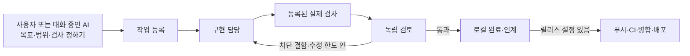

# Agent Workflow 사용 안내서

> 작성일: 2026-10-08 · 대상: v0.2.0 당시 구현과 파일럿 기록
>
> **이 도구는 AI에게 맡긴 작은 개발 작업의 진행 순서와 기록을 관리한다.**
> 목표와 완료 조건을 등록하면 구현 → 검사 → 다른 AI의 리뷰 → 필요한 수정 → 인계까지 연결한다. 릴리스 대상을 설정한 작업은 커밋·푸시·병합·배포도 이어서 수행한다.

처음에는 **한 프로젝트의 작은 작업 하나**에 사용한다. 프로젝트 전체를 알아서 계획하고 계속 개발하는 기능은 아직 없다.

**이 문서는 v0.2 시점 기록이다. 현재 기능·명령·설치 방법은 [v0.3 자동화 사용 안내](AUTOMATION_V0.3.ko.md)를 읽는다.** 아래의 미지원 항목 중 복구·환경 준비·웹 작업 등록·개별 중단·자동 시작은 v0.3에서 확장됐다.

추가 자동화를 구현했을 때의 형태는 [완성형 구성과 작업 흐름](workflow-blueprint.html)에서 볼 수 있다. 현재 구현과 미래 구성안을 구분한 시뮬레이션이며 실제 작업을 실행하지 않는다.

## 목차

1. [어떤 일을 맡길 수 있나](#1-어떤-일을-맡길-수-있나)
2. [어떤 구성으로 움직이나](#2-어떤-구성으로-움직이나)
3. [처음 사용하는 순서](#3-처음-사용하는-순서)
4. [대시보드에서 할 수 있는 일](#4-대시보드에서-할-수-있는-일)
5. [명령어 찾아보기](#5-명령어-찾아보기)
6. [막히거나 중단됐을 때](#6-막히거나-중단됐을-때)
7. [푸시·병합·배포까지 연결하기](#7-푸시병합배포까지-연결하기)
8. [완료 표시와 검증을 읽는 법](#8-완료-표시와-검증을-읽는-법)
9. [실제 Katakuri 작업에서 확인한 결과](#9-실제-katakuri-작업에서-확인한-결과)
10. [사내 반입과 다른 PC에서 사용하기](#10-사내-반입과-다른-pc에서-사용하기)
11. [현재 한계와 역할 분담](#11-현재-한계와-역할-분담)
12. [파일 위치와 근거](#12-파일-위치와-근거)

## 1. 어떤 일을 맡길 수 있나

예를 들어 다음과 같은 일을 맡길 수 있다.

- 화면에 빠진 조회 링크를 추가하고, 기존 버튼 동작이 유지되는지 검사한다.
- 재현 가능한 버그를 수정하고 관련 회귀 시험을 실행한다.
- 명확한 완료 조건이 있는 작은 WP를 구현하고 다른 에이전트의 리뷰를 받는다.
- 중단된 작업의 현재 코드와 인계 기록을 읽어 다음 세션에서 이어간다.
- 검증된 변경을 지정한 GitHub 저장소에 PR로 올리고, CI 확인 후 병합·배포한다.

WP는 **목표와 완료 조건이 정해진 작업 묶음**이다. 기존 WP 문서가 없어도 작업을 등록할 수 있다. 다만 무엇을 만들지, 무엇으로 확인할지는 정해야 한다.

| 하고 싶은 일 | 현재 지원 | 준비하거나 알아야 할 것 |
|---|---|---|
| 작업 등록·상태 조회 | 가능 | 프로젝트 경로, 목표, 완료 조건 |
| Claude 또는 Codex에 구현 맡기기 | 가능 | 선택한 CLI의 설치·로그인·사용 가능량 |
| 다른 에이전트에게 독립 리뷰 맡기기 | 가능 | 구현 담당과 다른 검토자 지정 |
| 실제 검사 실행 | 가능 | 프로젝트에 맞는 검사 명령 등록 |
| 지적받은 결함 수정 | 가능 | 설정한 추가 수정 횟수 안에서 진행 |
| 작업을 백그라운드로 실행 | 가능 | 데몬 기동 후 큐 등록 |
| 실패·중단 기록과 재개 | 부분 자동화 | 원인 확인과 재개 지시는 필요할 수 있음 |
| 다음 세션용 인계·worklog 초안 | 가능 | 전체 대화 export나 Obsidian 저장은 별도 |
| 자동 PR·병합·배포 | 조건부 가능 | 작업별 릴리스 설정, 원격 권한, 배포·상태 확인 명령 |
| 전체 프로젝트의 다음 일을 스스로 선정 | 전용 기능 없음 | 사용자나 대화 중인 에이전트가 선정 |
| 여러 에이전트의 병렬 작업을 자동 조율 | 전용 기능 없음 | 현재 기본 데몬은 한 번에 한 작업씩 처리 |
| 사용량 소진 시 계정·모델 자동 전환 | 없음 | 원인 해결 또는 담당자 변경 후 재개 |

## 2. 어떤 구성으로 움직이나

| 구성 | 쉬운 설명 | 실제 역할 |
|---|---|---|
| `agent-workflow` 스킬 | AI가 읽는 작업 안내서 | 현재 작업 확인, 등록, 검사, 리뷰, 인계 순서를 안내 |
| CLI | 작업 관리 명령 | 상태 저장, 검사 실행, 에이전트 호출, 릴리스 수행 |
| 작업 원장 | 작업 기록장 | 목표·진행 상태·검사·리뷰·중단 사유를 SQLite에 저장 |
| 데몬 | 계속 켜 두는 실행 프로그램 | 대기열에서 작업을 하나씩 꺼내 실행 |
| 대시보드 | 진행 상황을 보는 화면 | 등록된 작업 조회, 실행 요청, 대기 취소 |
| Codex·Claude CLI | 실제 일을 하는 에이전트 | 소스 읽기·수정 또는 독립 검토 |



이 도구에 AI 모델이 들어 있는 것은 아니다. 설치된 `codex`, `claude` 명령을 호출한다. 모델 사용량은 해당 CLI의 계정에서 발생한다.

스킬 자체는 상주 프로그램이 아니다. 에이전트가 스킬을 읽고 명령을 실행하거나, 사용자가 CLI·대시보드에서 실행을 요청해야 작업이 시작된다.

## 3. 처음 사용하는 순서

### 3.1 먼저 준비할 것

1. **작업할 Git 저장소**: 최소 한 개의 커밋이 있어야 한다.
2. **작업할 위치**: 다른 세션과 겹칠 수 있으면 별도 worktree를 준비한다. worktree는 같은 저장소를 별도 폴더·브랜치에서 작업하는 Git 기능이다.
3. **작은 목표와 완료 조건**: 예를 들어 “감사 ID가 있으면 기록 보기 링크를 표시하고, 없으면 링크를 만들지 않는다”.
4. **실제 검사 명령**: 목표와 관련된 테스트·타입 검사·린트 등.
5. **구현 담당과 검토자**: 기본은 Claude 구현, Codex 리뷰다.

현재 `create` 명령은 구현용 worktree를 자동으로 만들지 않는다. 이미 있는 작업 위치를 지정한다. 릴리스 과정에서 만드는 병합·배포용 checkout과는 별개다.

### 3.2 가장 쉬운 시작: 평소 대화에서 요청하기

작업할 프로젝트에서 Codex 또는 Claude를 열고 다음처럼 요청한다.

> agent-workflow 스킬을 사용해. 이 프로젝트에서 작업할 작은 항목 하나의 목표와 완료 조건을 확인하고 등록해.
> 구현은 Claude, 독립 리뷰는 Codex가 맡도록 해.
> 관련 검사와 작업 범위를 구체적으로 정해.
> 이번에는 로컬 구현·검증·인계까지 진행하고 release-config는 등록하지 마.

이 과정에서 작업을 고르고 검사 명령을 정하는 것은 **대화 중인 에이전트의 작업**이다. 데몬이 모든 프로젝트를 자동 탐색해 일감을 만드는 것은 아니다.

이미 등록된 작업을 이어갈 때는 ID를 지정한다.

> agent-workflow 스킬로 `작업ID`의 현재 상태와 인계를 확인하고 이어서 진행해.

### 3.3 직접 등록하는 예시

아래는 **웹 코드 작업용 템플릿**이다. 프로젝트 경로·목표·검사 파일을 실제 작업에 맞게 바꾼 뒤 실행한다. 예시에 있는 검사 하나만으로 모든 작업의 완료를 보장할 수는 없다.

```bash
agent-workflow create KB-NEXT-001 \
  --project /path/to/isolated-worktree \
  --goal '현재 상태의 기록 번호에서 기록 목록으로 이동할 수 있다' \
  --criterion '번호가 있으면 정확한 링크를 표시한다' \
  --criterion '번호가 없으면 링크를 만들지 않는다' \
  --check 'npm --prefix web test -- tests/risk.render.test.tsx --maxWorkers=2' \
  --owner claude --reviewer codex
```

- 작업 ID는 원장 전체에서 고유해야 한다. `KB-…`처럼 프로젝트 접두어를 붙이면 구분하기 쉽다.
- `--criterion`, `--check`, `--ref`는 여러 번 지정할 수 있다. `--ref`는 실제로 존재하는 파일 경로다.
- 검사 명령은 **저장소 루트에서** 실행된다. 하위 폴더 명령은 예시의 `--prefix web` 또는 별도 스크립트로 경로를 정한다.
- 검사 명령은 셸 없이 실행한다. `&&`, 파이프, 리다이렉션이 필요하면 검사 스크립트로 묶는다.
- `--owner codex`로 바꿀 때는 `--reviewer claude`도 지정한다. 같은 에이전트를 구현자와 독립 검토자로 지정할 수 없다.
- 작은 작업에서 독립 리뷰를 생략하려면 등록 시 `--reviewer none`을 명시한다.

### 3.4 계획 확인 후 실행

```bash
agent-workflow run KB-NEXT-001 --dry-run
agent-workflow run KB-NEXT-001 --timeout 1800 --repairs 1
```

`--dry-run`은 실행 계획을 출력한다. 실제 검사나 로그인·CI·배포 준비 상태를 검증한 결과는 아니다.

`run`과 `pipeline`은 현재 같은 실행 경로를 사용한다. **어느 명령이든 release-config가 있으면 릴리스까지 이어진다.** 로컬 작업에서 끝내려면 릴리스 설정을 등록하지 않는다.

| 옵션 | 기본값 | 뜻 |
|---|---|---|
| `--timeout` | 900초 | 에이전트·검사 프로세스별 시간 제한. 작업 전체의 총시간 제한은 아님 |
| `--repairs` | 1회 | 최초 시도 뒤 허용할 추가 수정 횟수. 0~3 지정 가능 |

예시의 1800초는 독해·구현 시간이 필요한 작업을 위한 선택이다. 시간을 늘려도 성공을 보장하지 않으며, 토큰·금액 예산을 제한하는 옵션도 아니다.

### 3.5 백그라운드로 맡기기

```bash
agent-workflow daemon start --port 8776
agent-workflow queue KB-NEXT-001 --timeout 1800 --repairs 1
agent-workflow jobs
```

브라우저에서 <http://127.0.0.1:8776>을 연다. 이 프로젝트에서는 다른 서비스와의 충돌을 피하기 위해 8776을 사용한다. 프로그램 기본 포트는 8765이므로 예시처럼 포트를 명시한다.

브라우저를 닫아도 데몬은 계속 실행된다. WSL이나 컴퓨터를 종료하면 프로세스도 종료된다. 다음 시작 때 `daemon start`가 필요하며, 재부팅 자동 시작 설정은 포함돼 있지 않다.

## 4. 대시보드에서 할 수 있는 일

| 화면 요소 | 할 수 있는 일 |
|---|---|
| 작업 목록·검색·상태 필터 | 등록된 작업 선택. `/` 키로 검색창 이동 |
| 단계 표시 | 구현·검증·리뷰·병합·배포 상태 확인. 생략·미설정·재확인 필요를 구분 |
| 체크포인트 | 마지막 작업과 다음 행동 확인 |
| 실행 기록 | 검사·리뷰·릴리스 사건과 필요한 상세 정보 확인 |
| 워크플로 실행 | 선택한 기존 작업을 큐에 등록 |
| 통합·배포 실행 | release-config가 있는 작업의 릴리스를 큐에 등록 |
| 대기 취소 | 아직 시작하지 않은 큐 항목 취소 |
| 테마 버튼 | 다크·라이트 전환. 브라우저에 선택 저장 |

**현재 대시보드에는 새 목표를 입력하는 채팅창이나 작업 등록 폼이 없다.** 등록·검사 명령·담당자·릴리스 대상 설정은 CLI 또는 에이전트와의 대화에서 한다. 로그 파일 전체를 탐색하는 화면도 없다. 필요한 경로는 `show`나 원장 기록에서 확인한다.

대시보드 실행 버튼은 현재 기본 시간 제한 900초·추가 수정 1회를 사용한다. 값을 조정하려면 CLI의 `queue` 명령을 사용한다.

## 5. 명령어 찾아보기

아래 `TASK_ID`, `JOB_ID`, 파일 경로는 자신의 값으로 바꾼다. TASK_ID는 **일감의 이름**, JOB_ID는 **그 일감을 실행한 한 번의 시도 번호**다. 한 작업에 실패·재개 이력이 여러 개 있을 수 있다.

| 목적 | 명령 | 실제 효과 |
|---|---|---|
| 설치 확인 | `agent-workflow doctor` | Git·CLI 경로와 버전 확인. 인증·사용량·모델 응답 성공까지 검사하지 않음 |
| 작업 목록 | `agent-workflow list` | 등록된 작업 요약 |
| 상세 확인 | `agent-workflow show TASK_ID` | 현재 Git 상태와 저장된 검사·리뷰·인계 정보 |
| 실행 입력 보기 | `agent-workflow brief TASK_ID` | 대화형 재개 지시문 출력 |
| 리뷰 입력 보기 | `agent-workflow brief TASK_ID --role review` | 독립 검토 입력과 결과 JSON 형식 출력 |
| 다음 행동 기록 | `agent-workflow checkpoint TASK_ID --summary '진행 내용' --next '다음 행동'` | 체크포인트 갱신. 검사 통과나 완료를 뜻하지 않음 |
| 검사 추가 | `agent-workflow check-add TASK_ID '실제 검사 명령'` | 검사 추가 및 기존 검사·리뷰 증거 무효화 |
| 검사만 실행 | `agent-workflow check TASK_ID` | 구현 모델 호출 없이 등록된 검사 실행. 기존 리뷰 판정은 초기화 |
| 전경 실행·재개 | `agent-workflow run TASK_ID` | 필요한 구현·검사·리뷰, 설정된 경우 릴리스까지 수행 |
| 대기열 등록 | `agent-workflow queue TASK_ID` | 데몬에 실행 요청. 데몬이 꺼져 있으면 대기 |
| 실행 이력 | `agent-workflow jobs` | JOB_ID, 대기·실행·종료 상태, 로그 경로 |
| 대기 취소 | `agent-workflow cancel JOB_ID` | queued 상태만 취소 |
| 담당 변경 | `agent-workflow assign TASK_ID --owner codex --reviewer claude` | 새 담당 지정. 실행 중인 같은 worktree의 잠금을 얻을 수 없으면 거부 |
| 완료 판정 | `agent-workflow finish TASK_ID` | 등록된 검사·지정 리뷰와 현재 코드가 일치하는지 확인 후 로컬 완료 |
| 인계 생성 | `agent-workflow handoff TASK_ID` | 재개문·상태 JSON·worklog 초안 생성 |
| 데몬 조회·종료 | `agent-workflow daemon status` / `agent-workflow daemon stop` | 서비스 조회 또는 종료 |

대화형 독립 검토 결과를 수동 등록할 때는 `result-schema`와 `review-import`를 사용한다. [스킬 명령 참고](../skills/agent-workflow/references/commands.md)에 형식이 있다. 다른 검토자의 실제 결과를 등록해야 하며, 구현 담당자가 예시 JSON을 복사해 독립 리뷰 통과로 처리하면 안 된다.

## 6. 막히거나 중단됐을 때

### 6.1 먼저 상태와 이유를 확인한다

```bash
agent-workflow show TASK_ID
agent-workflow jobs
```

`blocker`, `last_run.directory`, 검사 결과의 `stdout`·`stderr`, 작업 이력의 `log_path`를 확인한다. 상태는 마지막 기록이므로, 강제 종료 뒤에는 실제 프로세스와 Git 변경도 함께 확인한다.

### 6.2 코드가 남아 있다면 검사부터 이어갈 수 있다

시간 초과는 코드가 하나도 작성되지 않았다는 뜻이 아니다. **남아 있는 변경이 작업 범위에 맞는지, 등록된 검사가 완료 조건을 충분히 확인하는지 먼저 확인한다.** 아직 유효한 검사 통과 증거가 없다면 다음 순서로 재개할 수 있다.

```bash
agent-workflow check TASK_ID
agent-workflow run TASK_ID --timeout 1800 --repairs 1
```

`check`는 검사를 다시 수행하며 기존 리뷰 판정을 초기화한다. **현재 코드의 검사·리뷰가 이미 통과했다면 `check`를 반복하지 않고 `run`으로 재개한다.** 유효한 검사 통과 증거가 있고 차단 수정이 필요한 리뷰가 없으면 구현을 건너뛴다. 리뷰까지 유효하게 통과했다면 리뷰도 반복하지 않는다. 미완료 작업의 검사가 실패하거나 코드가 바뀌면 필요한 구현·검증 단계로 돌아간다.

**복구 경로는 있지만, 중단된 일을 항상 알아서 진단·재개하는 기능은 아니다.** Katakuri 파일럿도 부모 에이전트가 이 복구 순서를 선택해 실행했다.

### 6.3 계정 한도나 사용 가능한 에이전트가 달라졌다면

원인을 해결한 뒤 재개하거나, 작업이 더 이상 실행 중이 아님을 확인하고 `assign`으로 담당자를 바꾼다. 도구가 계정을 자동 전환하거나 한도 해제 시각까지 기다렸다가 자동 재시작하지는 않는다.

### 6.4 실행 중인 일을 멈추려면

`cancel JOB_ID`는 대기 중인 작업에만 적용된다. 현재 버전에는 실행 중인 작업 하나만 중단하는 전용 명령이 없다.

터미널에서 전경으로 실행한 `run`·`pipeline`은 해당 터미널의 **Ctrl+C**로 중단한다. 도구가 관리하는 하위 프로세스도 종료한다. 중단 뒤에는 `show`와 Git 변경·로그를 확인하고 6.2의 순서로 재개한다. 원격 푸시·병합·배포 도중이었다면 실제 원격 결과도 확인한다. 이 전경 실행은 큐 작업이 아니므로 `jobs`에 별도 실행 항목이 생기지 않는다.

`daemon stop`은 대시보드와 큐 worker를 종료하고, worker가 수행 중인 관리 작업도 중단한다. 이미 수행된 파일 변경·원격 작업을 되돌리지는 않는다. 재시작하면 대기열은 남고, 실행 중이던 작업은 중단 상태로 기록되며 자동 재실행되지 않는다.

## 7. 푸시·병합·배포까지 연결하기

이 기능은 작업마다 목적지를 지정해야 한다. 다음 예시는 **이미 승인된 실제 대상**으로 값을 바꿔 사용할 때의 형태다.

```bash
agent-workflow release-config TASK_ID \
  --repo OWNER/REPO \
  --remote origin --base main --branch workflow/task-branch \
  --path src --path tests \
  --deploy 'python3 scripts/deploy.py' \
  --health 'python3 scripts/health.py'

agent-workflow pipeline TASK_ID --dry-run
agent-workflow pipeline TASK_ID
```

배포 스크립트와 health 스크립트는 해당 프로젝트에 실제로 있어야 한다. 이 도구가 호스팅 계정·배포 구성을 자동으로 만들어 주지는 않는다. 배포 없이 푸시·병합까지만 하려면 `--deploy`와 `--health`를 둘 다 생략한다.

실행 순서는 다음과 같다.

1. 현재 코드에 대한 검사·리뷰와 로컬 완료 상태를 확인한다.
2. 등록된 파일 경로 안의 변경만 커밋한다. 경로 밖 변경이 있으면 멈춘다.
3. 지정한 작업 브랜치를 강제 덮어쓰기 없이 푸시한다.
4. GitHub PR을 생성하거나 같은 후보 커밋의 PR을 이어간다.
5. 원격 CI와 병합 가능 상태를 확인하고, 후보 커밋 SHA를 지정해 병합한다.
6. 배포가 설정됐다면 병합된 커밋의 별도 checkout에서 필수 검사를 다시 실행한다.
7. 배포 명령과 health 명령을 실행해 결과·배포 revision을 기록한다.

적용 조건과 제한:

- 자동 커밋 대상 작업은 **깨끗한 Git 기준선에서 등록**해야 한다.
- 원격 URL과 지정한 저장소가 일치해야 한다. 현재 GitHub 모드는 `github.com`만 지원한다.
- `--path`는 자동 커밋 경계다. 구현 에이전트의 모든 파일 쓰기를 강제로 제한하는 장치는 아니다. 세부 변경 범위는 별도 검사와 CLI 권한 설정으로 확인한다.
- `scope`는 에이전트에게 전달하는 범위 지시다. “배포 금지”라는 문장만으로 이미 설정된 release-config가 꺼지지는 않는다.
- CI가 없는 저장소는 `--allow-no-ci`를 명시해야 한다. 실패한 CI를 통과로 바꾸는 옵션이 아니다.
- 배포 프로그램은 `WORKFLOW_REVISION`·`WORKFLOW_TASK_ID`를 받는다. health 프로그램은 기대한 버전이 실제로 적용됐는지 확인하도록 프로젝트에서 작성해야 한다.
- 성공한 배포를 같은 작업으로 다시 호출해도 반복 적용하지 않는다. 배포 성공 후 health만 실패하면 다음 호출은 health부터 재개한다.
- 배포 결과가 실패·불명확하면 실제 적용 상태를 확인한 후에만 `release TASK_ID --retry-deploy`로 재시도한다.

**이미 등록한 릴리스 설정을 해제하는 전용 명령은 없다.** 기존 작업을 로컬 실행으로 전환하려면 같은 프로젝트에 새 작업 ID를 등록하고, 필요한 목표·완료 조건·검사·참조 문서를 옮기되 release-config는 등록하지 않는다. 기존 파일 변경은 남아 있지만 새 작업의 검사·리뷰 증거는 다시 확보해야 한다. 기존 작업이 실행 중이거나 큐에 대기 중이라면 먼저 해당 실행을 정리한다.

현재 검증된 실제 푸시·병합·배포는 **로컬 bare Git 원격을 사용하는 시범 환경**이다. GitHub API 요청의 경계는 시험했지만 외부 운영 저장소의 실제 배포까지 검증했다고 보지는 않는다.

## 8. 완료 표시와 검증을 읽는 법

세 가지 기록을 따로 본다.

| 기록 | 예 | 의미 |
|---|---|---|
| 작업 상태 | `ready`, `implementing`, `checking`, `reviewing`, `blocked`, `completed` | 일감의 로컬 진행 상태 |
| 실행 시도 상태 | `queued`, `running`, `failed`, `interrupted`, `succeeded` | 특정 JOB_ID의 실행 결과 |
| 릴리스 상태 | `committed`, `pushed`, `merged`, `deploying`, `deployed` | 저장소 통합·배포의 실제 진행 상태 |

**`completed`는 등록된 로컬 검사와 지정 리뷰가 통과했다는 뜻이다.** 병합·배포·실사용 환경의 확인은 별도다. 테스트 명령을 부족하게 등록하면 목표에 비해 약한 완료 판정이 될 수 있다.

`show`의 `verification_is_current`, `review_is_current`, `completion_is_current`는 저장된 증거와 현재 코드가 일치하는지 보여준다. 릴리스가 같은 내용을 커밋한 경우에는 `evidence_bound_via_release`로 그 연결을 표시한다.

검사에 사용한 코드가 바뀌면 재확인이 필요하다. **이미 `completed`인 작업에서 코드를 추가로 바꿨다면 새 작업 ID로 등록해 검증한다.** 완료된 작업은 `check`나 계약 변경을 받지 않는다.

Git이 무시한 파일, 환경변수, 외부 데이터까지 모두 코드 지문으로 묶는 것은 아니다. 그런 입력이 결과를 좌우하면 작업별 검사에서 별도로 확인해야 한다.

## 9. 실제 Katakuri 작업에서 확인한 결과

2026-10-08에 `KB-O-CURRENT-AUDIT`로 **A-002 현재 감사 ID → 기존 감사 목록 링크**를 구현했다.

| 항목 | 실제 결과 |
|---|---|
| 제품 코드 | 컴포넌트 한 파일 수정 |
| 관련 시험 | 기존 68개 + 추가 12개, 총 80개 통과 |
| 다른 검사 | 독립 수용 검사, 타입 검사, 린트, 변경 범위 검사 통과 |
| 리뷰 | Codex 독립 리뷰 PASS |
| 브라우저 | 격리 화면에서 실제 컴포넌트·합성 API로 새 탭과 상태 보존 확인 |
| 중단 | Claude가 파일 작성 후 최종 JSON 응답 전에 900초 제한으로 종료 |
| 복구 | 부모 에이전트가 변경을 확인·검사하고 기록을 정정한 뒤 재개. 구현 재호출 없이 리뷰로 연결 |
| 최종 적용 범위 | 전용 브랜치에서 로컬 완료. 커밋·푸시·병합·운영 배포는 하지 않음 |

이 사례는 **실제 작업을 도구로 처리할 수 있음**을 보여준다. 복구 개입 1회가 있었으므로 무감독 자동 성공으로 세지 않는다. 검사·리뷰 연결은 도구가 했지만, 파일럿 선정·작업 계약·맞춤 검사·브라우저 확인 준비는 부모 에이전트가 했다.

개발 환경의 증거: [파일럿 설명](../pilots/KB-O-CURRENT-AUDIT/README.md), [실행 결과](../pilots/KB-O-CURRENT-AUDIT/result.json), [검토용 패치](../pilots/KB-O-CURRENT-AUDIT/changes.patch). 이 링크는 별도 보관된 파일럿 자료가 있어야 열린다.

## 10. 사내 반입과 다른 PC에서 사용하기

### 환경별 사용 가능 범위

| 환경 | 현재 판단 |
|---|---|
| Linux/WSL2, 필요한 CLI 호출 가능 | 현재 도구를 설치해 사용할 수 있는 대상 |
| Windows 네이티브 | 지원 대상으로 검증하지 않음. Linux의 `fcntl`·`/proc` 사용 |
| 완전 폐쇄망 | 원장·대시보드·로컬 검사·인계는 사용 가능. 현재 AI 호출 경로는 그대로 사용하기 어려움 |
| github.com | 현재 자동 릴리스 연결 대상 |
| 사내 GitHub Enterprise·GitLab·Bitbucket | 현재 원격 릴리스 어댑터에 추가 구현 필요 |
| 여러 직원이 공동 접속하는 서버 | 현재는 loopback 개인용. 팀 인증·권한·원격 공개 기능 없음 |

### 설치 순서

소스와 스킬을 가져간 폴더에서 실행한다. 설치기는 이 폴더를 가리키는 심볼릭 링크를 만들므로 설치 후에도 원본 폴더를 유지한다.

```bash
python3 install.py
~/.local/bin/agent-workflow doctor
~/.local/bin/agent-workflow daemon start --port 8776
```

이미 설치한 뒤 소스 폴더를 옮기면 기존 링크가 자동으로 갱신되지는 않는다. 다음 순서로 이전 설치를 정리한다.

1. 진행 중인 작업의 상태와 로그를 확인하고 데몬을 종료한다.
2. 새 폴더에서 `python3 install.py`를 실행한다. 기존 링크가 이전 위치를 가리키면 설치기가 충돌 경로를 알려 준다.
3. 해당 경로가 **이 도구의 이전 설치를 가리키는 심볼릭 링크**인지 확인하고 그 링크를 제거한다. CLI 링크와 이미 설치된 프로필의 스킬 링크 모두 확인한다.
4. 새 폴더에서 설치기를 다시 실행하고 `doctor`로 확인한다. 실제 파일이나 다른 설치의 폴더가 충돌한다면 그 항목의 용도를 먼저 확인한다.

Python 3.11 이상과 Git이 필요하다. 도구 자체는 외부 Python 패키지 없이 설치된다. AI 작업에는 사용할 Codex·Claude CLI와 로그인, GitHub 릴리스에는 `gh`, 프로젝트 검사에는 해당 프로젝트의 빌드·시험 도구가 별도로 필요하다.

설치기는 이미 있는 `.codex`, `.claude`, `.claude-soonho`, `.claude-alex` 프로필의 스킬 폴더에 같은 원본을 연결한다. 해당 프로필이 없으면 그 연결은 만들지 않는다. `agent-workflow`가 PATH에서 보이지 않으면 위처럼 전체 명령 경로를 사용한다.

현재 개발 환경에서 확인한 CLI 버전은 Codex 0.160.1, Claude Code 2.1.292다. 다른 환경은 실행 옵션 호환성을 확인해야 한다. `doctor` 성공만으로 실제 모델 호출까지 검증됐다고 보지 않는다.

### 무엇을 옮기나

- 실행에 필요한 소스: `agent_workflow/`, `bin/`, `skills/`, `install.py`, `pyproject.toml`, README와 사용 안내서.
- 선택 항목: 시험 소스 `tests/`. 브라우저 회귀 검사는 별도로 Playwright가 필요하다.
- 개인 상태·로그·원본 대화·인증 정보·테스트용 `artifacts/`는 기본 반입 묶음에서 제외한다. 개발용 `pilots/`도 대상 환경 경로에 맞춘 별도 자료이므로 그대로 실행하지 않는다.
- 작업 원장에는 절대 프로젝트 경로가 들어 있다. 다른 PC에 원장을 통째로 복사하면 그대로 재개된다고 보장하지 않는다. 새 환경의 경로로 작업을 다시 등록하고 필요한 인계 내용만 검토해 옮긴다.

사내에서 AI 자동 실행을 하려면 허용된 모델 연결·계정을 사용해야 한다. 소스와 도구 출력이 선택한 CLI의 모델 서비스로 전달될 수 있다. 사내 프록시·모델 게이트웨이에서의 실제 동작은 아직 검증하지 않았다.

## 11. 현재 한계와 역할 분담

**사람 또는 감독하는 에이전트가 정할 것:** 다음 작업, 우선순위, 완료 조건, 검사 명령, 소유 파일, 모델 역할, 외부 작업 대상과 범위, 불명확한 결과의 처리.

**도구가 반복 처리할 것:** 등록된 실행 순서, 검사 실행, 결과 전달, 제한된 수정 반복, 코드와 증거의 연결 확인, 큐·진행 기록, 인계 생성, 설정된 릴리스.

현재 자동화하지 않는 일은 다음과 같다.

- 전체 대화 이력을 계속 읽고 새 작업을 스스로 발굴하는 일
- 프로젝트별 규약을 완전히 이해해 모든 문서·원장을 자동 동기화하는 일
- 작업 난도에 따라 모델을 자동 선택하거나 계정·사용량을 자동 관리하는 일
- 구현용 worktree 자동 배정, 여러 트랙의 소유권 예약·병합 충돌 자동 조율
- 중단 원인을 모두 분류해 무조건 자동 복구하는 일
- 문제 발생 시 메신저로 능동 알림을 보내는 일
- 전체 대화 export, Obsidian worklog 저장, 기존 handoff 팩 갱신의 완전 자동 연결

Claude 자동 구현은 현재 `--safe-mode`와 파일 읽기·편집 도구를 사용한다. 평소 대화형 세션의 플러그인·훅·메모리·모든 도구가 그대로 이어지는 것은 아니다. 필요한 검사와 검증 환경은 실행 계획에 연결해야 한다.

같은 worktree의 관리 실행은 파일 잠금으로 겹침을 막지만, 도구 밖의 에디터나 다른 에이전트까지 막지는 못한다. 종료된 작업의 임시 자원·worktree를 자동으로 모두 정리하는 기능도 없다.

## 12. 파일 위치와 근거

| 위치 | 내용 |
|---|---|
| 프로젝트 폴더 `/home/roqkf/agent-workflow` | 도구 소스·스킬·사용 안내 |
| `~/.local/bin/agent-workflow` | 설치된 명령 링크 |
| `~/.local/state/agent-workflow/state.sqlite3` | 기본 작업·이벤트·큐 원장 |
| 상태 폴더의 `tasks/TASK_ID/runs/` | 모델 실행 입력·출력·오류·결과 |
| 상태 폴더의 `tasks/TASK_ID/checks/` | 검사별 실제 명령·종료 코드·로그 |
| 상태 폴더의 `tasks/TASK_ID/handoff/` | `state.json`, `resume.txt`, `worklog.md` |
| 상태 폴더의 `tasks/TASK_ID/release/` | 릴리스 작업 사본과 명령 로그 |
| 상태 폴더의 `jobs/`, `server.log` | 큐 작업 로그와 서버 로그 |

상태 폴더는 `AGENT_WORKFLOW_HOME` 또는 전역 옵션 `--home`으로 바꿀 수 있다. `--home`은 명령 앞에 둔다.

```bash
agent-workflow --home /path/to/separate-state list
```

이 안내서는 [CLI](../agent_workflow/cli.py), [실행기](../agent_workflow/runner.py), [완료 판정·저장](../agent_workflow/core.py), [큐](../agent_workflow/daemon.py), [릴리스](../agent_workflow/release.py), [서버](../agent_workflow/server.py), [설치기](../install.py)를 대조해 작성했다.

기존 검증 기록: [v0.2 검사·로컬 릴리스](verification-v0.2.json), [대시보드 검사](verification-ui-redesign.json). 테스트가 확인한 범위와 실제 운영에서 확인하지 못한 범위를 함께 읽는다.
